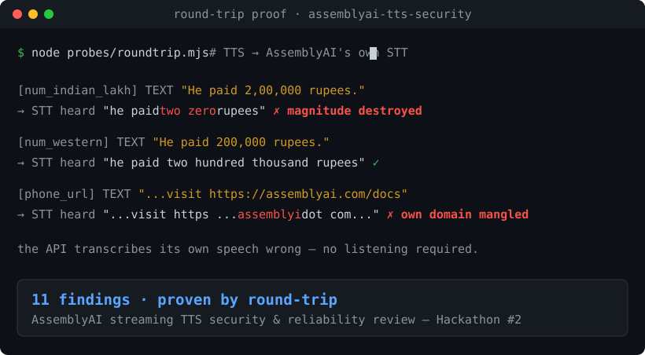

# assemblyai-tts-security

A security & reliability review of AssemblyAI's **undocumented** streaming
text-to-speech endpoint `wss://streaming-tts.assemblyai.com/v1/ws`, built for
**AssemblyAI online Hackathon #2** (Oct 15–23 2026), bug-report / security track.

The endpoint shipped with no public docs. We probed it black-box with our own
hackathon key and found **11 issues** — two of them proven by round-trip (we
transcribe the TTS audio with AssemblyAI's *own* STT, so the proof is the API
contradicting itself, not our ears) — plus a set of negative (robust) results.
Full writeup: **[FINDINGS.md](FINDINGS.md)**.



*The clip above is the flagship finding, proven by round-trip. Run it yourself offline:
`node demo/roundtrip-demo.mjs` (instant scoreboard) or live: `node --env-file=.env probes/roundtrip.mjs`.*

## Headline findings

1. **Indian ₹ amounts spoken as gibberish** — `2,00,000` (two lakh) is synthesized as
   **"two zero"**, `1,50,00,000` (1.5 crore) as **"one fifty zero"**; the same values in
   Western grouping read correctly. Round-trip-proven. (F10)
2. **`Terminate` bills un-flushed text** — buffer text, never `Flush`, `Terminate`: you're
   still billed for synthesized audio you never requested. Only `Cancel` discards a buffer. (F1)
3. **Cancelled audio is billed but reported as `0` s** — `Cancelled.audio_duration_seconds`
   is always `0` while the session bills the full cancelled utterance (19.84 s in our repro). (F2)
4. **Non-deterministic `WordBoundaries`** — the *same* input intermittently returns no word
   timings with audio and no error, silently breaking captions. (F4)
5. **AssemblyAI's own domain is mangled** — `assemblyai.com` → "assemblyi dot com". (F11)
6. **Validation asymmetry, control-char passthrough, segment gluing, misleading `voice_clone`
   error, info disclosure** — see report. (F5–F9)

## Results scoreboard

All 11 findings are reproducible; each row names the one-file script that demonstrates it.

| # | Severity | Finding | Status | Repro |
|---|----------|---------|--------|-------|
| F10 | Medium | Indian lakh/crore grouping `2,00,000` spoken as "two zero" | ✅ | `probes/roundtrip2.mjs` |
| F1 | Medium | `Terminate` bills text never flushed | ✅ | `probes/a_billing2.mjs` |
| F2 | Medium | `Cancelled` reports `0 s` while session bills full cancelled audio | ✅ | `probes/a_billing.mjs` |
| F4 | Medium | Non-deterministic `WordBoundaries` (~7% drop, no error) | ✅ | `probes/e4_quant.mjs` |
| F11 | Low–Med | `assemblyai.com` → "assemblyi dot com" | ✅ | `probes/roundtrip.mjs` |
| F5 | Low–Med | `voice`/`language` enforced at connect, ignored per-`Generate` | ✅ | `probes/c_info.mjs` |
| F3 | Low | Usage counters (`chars` vs `audio_seconds`) can't be reconciled | ✅ | `probes/bcd_fuzz.mjs` |
| F6 | Low | `Generate` segments concatenated with no separator | ✅ | `probes/a_billing.mjs` |
| F7 | Low | Control chars (NUL/ANSI/BEL) pass through into `WordBoundaries` | ✅ | `probes/bcd_fuzz.mjs` |
| F8 | Low | `voice_clone` error advertises a disabled feature | ✅ | `probes/c_info.mjs` |
| F9 | Info | Parser exception + server version strings leaked | ✅ | `probes/bcd_fuzz.mjs` |

Plus a **tested-and-robust** section (no `text` injection, no `flush_id` spoofing, clean type
rejection) in [FINDINGS.md](FINDINGS.md).

## Run it

Requires Node 22+ (built-in `WebSocket`). No dependencies.

```bash
printf 'ASSEMBLYAI_API_KEY=%s\n' "$YOUR_KEY" > .env
node --env-file=.env probes/a_billing.mjs    # billing cluster (F1–F3)
node --env-file=.env probes/e3_flaky.mjs     # non-deterministic WordBoundaries (F4)
node --env-file=.env probes/bcd_fuzz.mjs     # validation + state machine (F6, F7, F9, negatives)
node --env-file=.env probes/c_info.mjs       # validation asymmetry + clone ordering (F5, F8)
node --env-file=.env probes/e_pronounce.mjs  # normalization WAVs -> evidence/wav/
```

## Layout

```
probes/      reproduction scripts (one battery per file) + lib.mjs harness
evidence/    captured raw output (*.txt) and synthesized audio (wav/*.wav)
FINDINGS.md  the report: per-finding severity, repro, observed output, suggested fix
```

## Scope & ethics

Testing was black-box against the production endpoint with **our own** hackathon
API key, at low request volume, with no denial-of-service and **no other accounts
accessed**. We mapped the voice-cloning surface by confirming it is *disabled* on
this deployment; we did not submit any reference clip or attempt to clone a voice.
Findings are shared for AssemblyAI to fix. The API key lives only in a gitignored
`.env` and never appears in code or evidence.
